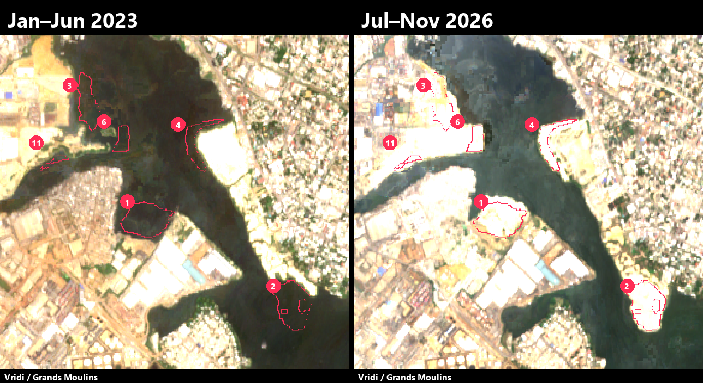

# Ghost Lakes: finding the water that cities bury
*Track: Climate · Team of 2 students (Luca Valentin Mureșan, Vlad Mihai Tutunaru)*

We used AI and free satellite data to find lakes and lagoons that cities fill in and build on, including ones being filled right now.

## Why?

| Risk | Real example (the ground stays soft and rain still flows there) |
|---|---|
| **Floods** | Chennai 2015: a parliamentary committee found that encroachment on lakes and riverbeds played a major role.[^1] Hyderabad 2020: about half of the city's lakes had been encroached.[^2] |
| **Building collapse** | Rana Plaza, Dhaka 2013 (over 1,100 dead): part of it stood on a pond filled with rubbish.[^3] |
| **Earthquakes** | Mexico City 1985: severe damage was confined to the old lake bed, whose soft clay amplified the shaking.[^4] |
| **Cost** | USA: wetland loss since 1985 added about $10 billion to flood insurance claims (*Nature Water*, 2026).[^5] |

## Already known around the world
Mexico City (built on drained Lake Texcoco), Phnom Penh (15 of 25 lakes filled by 2019)[^6] and San Francisco's Marina District (a lagoon filled for the 1915 World's Fair)[^7] are well documented. Our detectors **re-found known cases on their own**: Kalikiliki Dam (Lusaka)[^8], Parangipalya Lake (Bengaluru)[^9] and Phnom Penh's lakes. Most large fills of 2023–2026 worldwide are public port and coastal projects (Dubai, Singapore, Manila Bay). Nothing new, but it shows the method works.

## What we found: Abidjan's Ébrié lagoon
- **11 sites, 33 ha of lagoon water became land between 2023 and 2026.** 32 ha of it came from 2024 on, after lagoon infill was **suspended in 2023**.[^10] Each site had been lagoon water for decades, and radar confirms every one.
- **About 75,000 people live within 500 m**, many of them in Koumassi. Abidjan already floods badly: 24 people died in floods and landslides in June 2024.[^11]

**Why this is new.** Only totals had been made public: 453 ha filled overall (all years)[^12] and reports that infill continues in several sectors,[^13] with no locations, maps or dates. To our knowledge, ours is the first public site-by-site map with dates. We ran the same rule, unchanged, on **all 26,336 urban areas on Earth**:

- Abidjan ranks 11th of 354 radar-confirmed areas.
- Of the 48 largest we checked by eye, only Abidjan and Lagos fill lagoon water inside neighbourhoods.
- This is a consistency check, not an independent test, because the rule was designed on Abidjan.

*Vridi / Grands Moulins, Sentinel-2, 2023 vs 2026: inside each red outline, lagoon water became sand.*

**How did we do it?** A Random Forest learns where water tends to be from terrain alone: 10 features, 23,000 points, 7 Romanian regions. Trained on 6 regions and tested on the 7th, it scores **AUC 0.977** on average. But on 4 old water bodies under central Bucharest (2 ponds, 2 streams now in pipes)[^14], it scores only 0.57, barely better than guessing (0.5). Filling or piping water levels the ground, so terrain alone does not show it. So we compared satellite images over time instead: water before (Landsat archive or 2023), land today, confirmed by radar and checked by hand.

## Datasets used
| Free data (Google Earth Engine) | What it gave us |
|---|---|
| JRC Global Surface Water (Landsat, 1984–2021) | where water stood for decades: training labels and the archive detector |
| Dynamic World (Google's AI land-cover maps) | water vs built-up or bare land, 2023 vs 2026 |
| Sentinel-1 radar + Sentinel-2, Landsat 5 | a second check through clouds and the date of each fill; images to check by eye |
| FABDEM + MERIT Hydro + GHSL 2025 | terrain (elevation, hollows, height above rivers), people nearby and urban areas |

**Checked by hand.** We looked at before/after images of every radar-confirmed hit in over 100 cities. 79% of them were real infill (95% of the area); the rest were moving rivers, beaches and one drained lake.

## Limits and next steps
- **Can't tell** whether a fill was authorised (Vridi port works may be legal); we accuse no one.
- **Misses** vegetated marshes and small fills under 0.5 ha (33 ha is a lower bound). Dates are uncertain for 4 of the 11 sites.
- **Next:** ground checks with local journalists and lagoon authorities, marsh detection and a flood model.

[^1]: [The News Minute (Parliament committee report)](https://www.thenewsminute.com/article/did-chennai-learn-any-lessons-2015-floods-70597)
[^2]: [The Hans India](https://www.thehansindia.com/news/cities/hyderabad/hyderabad-encroachers-threaten-to-gobble-up-kappala-cheruvu-691917)
[^3]: [Gulf News (government probe)](https://gulfnews.com/world/oceania/owners-failings-led-to-factory-collapse-1.1187447)
[^4]: [NZ Society for Earthquake Engineering](https://bulletin.nzsee.org.nz/article/view/851/826)
[^5]: [Environmental Defense Fund](https://www.edf.org/media/new-study-shows-wetlands-loss-has-increased-residential-flood-insurance-claim-payments-10)
[^6]: [Malay Mail, 2019](https://www.malaymail.com/news/life/2019/07/15/phnom-penh-poor-uprooted-as-lakes-filled-in-for-malls-flats/1771442)
[^7]: [California Geological Survey](https://conservation.ca.gov/cgs/Documents/Melange/Marina%20Poster.pdf)
[^8]: [Nchito, Environment & Urbanization, 2007](https://journals.sagepub.com/doi/10.1177/0956247807082835)
[^9]: [30 Stades, Bengaluru's lost lakes](https://30stades.com/environment/bengaluru-43-lost-lakes-and-what-stands-on-them-today-water-crisis-4435946)
[^10]: [Fratmat / AllAfrica, Feb 2026](https://fr.allafrica.com/stories/202602130183.html)
[^11]: [Afrik.com, June 2024](https://www.afrik.com/abidjan-devastee-par-des-inondations-24-morts-et-de-nombreux-degats)
[^12]: [Fratmat, Mar 2026](https://www.fratmat.info/article/2640461/economie/plan-deau-lagunaire-a-abidjan-sur-56-000-hectares-4531-hectares-ont-ete-remblayes-revele-le-dg-des-affaires-maritimes)
[^13]: [Ivoireactu, Sep 2026](https://www.ivoireactu.net/abidjan-malgre-les-mises-en-garde-de-letat-le-dragage-illegal-de-la-lagune-ebrie-continue/)
[^14]: [Bucharest.ro](https://www.bucharest.ro/articles/the-bucurestioara-stream-where-does-the-vanished-tributary-of-the-dambovita-flow-today-1498)
