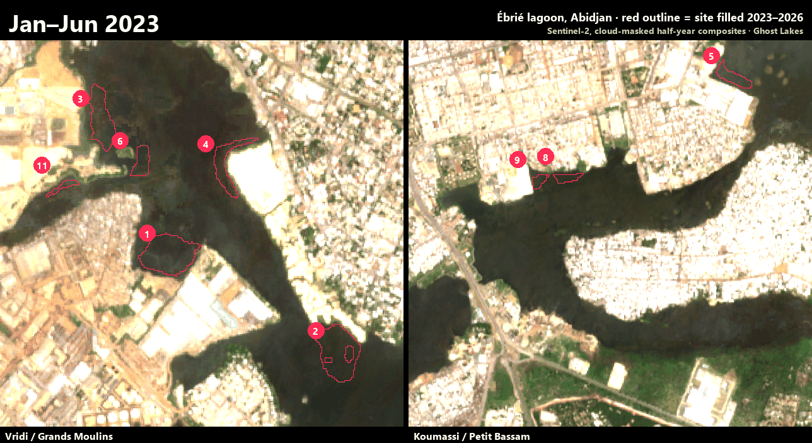

# Ghost Lakes: A ban on paper, sand in the water

**AI + 40 years of free satellite data to find water that cities bury, and to check whether it is still being buried.**
Climate track · Veritas AI International High School Hackathon 2026 · team of 2.



*Half-year Sentinel-2 composites, 2023 → 2026. Watch the inside of each red outline: dark lagoon water turns into bright sand.*

> In 2023 Côte d'Ivoire suspended the filling-in of Abidjan's Ébrié lagoon. Officials later published only totals: no maps, no sites, no dates.
> Ghost Lakes found **11 sites where 33 ha of lagoon became land between 2023 and 2026** (32 ha from 2024 on). Every site is confirmed by two independent satellites.
> **Two sites were filled in March–April 2026, after the minister's public warning.** About **75,000 people** live within 500 m of these sites.

## Start here (2 minutes)
| What | File |
|---|---|
| One-page write-up | [`WRITEUP.pdf`](WRITEUP.pdf) ([markdown](WRITEUP.md)) |
| Every number and test, recomputed from saved outputs (renders on GitHub, no account needed) | [`RESULTS.ipynb`](RESULTS.ipynb) |
| Interactive map: 2023 vs 2026 imagery, each site with dates, radar and population (download, then open in a browser) | [`outputs/abidjan/abidjan_map.html`](outputs/abidjan/abidjan_map.html) |
| Main figure (before/after + per-site timeline, optical and radar) | [`outputs/abidjan/figure_before_after.png`](outputs/abidjan/figure_before_after.png) |
| Every site up close at four dates (visual proof) | [`outputs/abidjan/sites_zoom.png`](outputs/abidjan/sites_zoom.png) |
| Site list for journalists and authorities (CSV / GeoJSON with map links) | [`outputs/abidjan/abidjan_sites.csv`](outputs/abidjan/abidjan_sites.csv) |
| One-page brief in French, for people in Abidjan | [`docs/BRIEF_FR.pdf`](docs/BRIEF_FR.pdf) |
| Demo video script | [`docs/VIDEO_SCRIPT.md`](docs/VIDEO_SCRIPT.md) |

## What it does
Three detectors look at different time scales, and a human reviews every hit.

1. **Terrain AI: where water *should* be.** A Random Forest (Earth Engine) learns from 23,000 points in 7 Romanian regions where water occurs, using only terrain: bare-earth DEM, depressions, slope, height above drainage, wetness and distance to rivers. Applied to cities, it flags built-up land whose terrain "wants" to be water. (`ghostlakes/terrain.py`)
2. **Archive detector: where water *was*.** Finds water seen by Landsat before 2010 that has been dry since 2015 and is built-up today. We ran it on 84 cities. (`ghostlakes/archive.py`)
3. **Infill monitor: where water is disappearing *now*.** Compares Dynamic World 2023 vs 2026, confirms every site with Sentinel-1 radar (which sees through clouds), dates each change and counts people nearby. It runs on any place with one command (`ghostlakes/infill.py`).
4. **Human review:** old vs new imagery, OpenStreetMap, news and the scientific literature.

## Testing and honesty
| What we measured | Result |
|---|---|
| Terrain AI, leave-one-region-out (7 regions) | mean AUC **0.977**, F1 0.906 (balanced test sets) |
| Terrain AI on 4 documented, fully vanished water bodies in Bucharest (trained without Bucharest) | AUC **0.57**, close to chance, so terrain alone is not enough |
| Archive detector finds known lost lakes on its own | Kalikiliki Dam, Lusaka (archive: water until 2005, dry from 2007; a 2007 paper says it was "allowed to dry up" in late 2006); Parangipalya Lake under Bengaluru's HSR Layout; Phnom Penh's filled lakes |
| Abidjan area, inside our polygons | **98%** confirmed by an independent reflectance rule, **91%** by radar |
| Abidjan area, sensitivity to thresholds | 20–47 ha (default 33 ha); edges suggest the true extent is larger |
| Abidjan dates, optical vs radar | agree within 3 months for **7 of 11** sites; differ 6–20 months for 4 (reported as uncertain) |
| Global infill screen, ~120 cities, every radar-confirmed hit labelled by eye | **23 of 29 (79%)** are real infill, **95% by area**; 5 are moving rivers or beaches, 1 a lake drained for works |
| Blind world scan: every urban area on Earth (26,336 cells of 0.1°), water → land 2023→2026, radar per cell; 48 largest non-river cells labelled by eye | **503** cells changed (1,712 ha). Most are official ports and coastal reclamation. **Abidjan surfaces without being named** and is one of only 2 cities (with Lagos) where lagoon water is filled inside neighbourhoods (`outputs/world/review.md`) |
| Unit tests (pure logic: radar rule, dating, summaries) | `python -m pytest -q` → 19 passed |

**Where it fails**
- The terrain AI misses lakes that left no trace in the terrain, and its Romanian top candidates were artefacts (a sunken stadium pitch, excavations). We claim no discovery in Romania.
- Moving rivers and beaches can look like infill, so human review is required.
- The infill rule sees only open water that has lasted for decades. It misses vegetated marsh, and the world scan misses fills smaller than about 1 ha per cell.
- The MNDWI water index fails in this turbid lagoon; we replaced it with a NIR/SWIR rule.
- We cannot tell legal from illegal fill (Vridi is a port area), and we never claim illegality.

## Run it yourself
```bash
python -m venv .venv
.venv\Scripts\pip install -r requirements.txt
.venv\Scripts\earthengine authenticate
```
Set your Earth Engine project id in `ghostlakes/common.py` (`PROJECT = "..."`). Everything goes through `run.py` (`python run.py --help`):

```bash
python run.py monitor --name abidjan --box -4.12 5.22 -3.70 5.42 --then 2023-01-01 2023-07-01 --now 2026-04-01 2026-11-15
```
This monitors **any place**: change `--box` and the dates. It writes `outputs/monitor/<name>/sites.csv` and `.geojson`.

| Command | What it does |
|---|---|
| `python run.py abidjan` | The Abidjan case study, every number in the write-up: detect → timing → accuracy → population → table → figure → timelapse |
| `python run.py terrain` / `validate` | Terrain AI: training, leave-one-region-out test, Romanian candidates / documented drained lakes |
| `python run.py archive` / `screen` | Archive detector (84 cities) / 2023→2026 infill screen (~120 cities) |
| `python run.py world scan` / `world hotspots` | Blind world scan: start the Earth Engine batch job (~1 h) / rank the cells into `outputs/world/cells.csv` |
| `python run.py radar` / `review` | Radar check for any polygons / image chips and OSM checks for manual review |
| `python run.py report` | Rebuild `RESULTS.ipynb` and the one-page PDFs (no Earth Engine needed) |
| `python -m pytest -q` | Unit tests (no Earth Engine needed) |

## Repository layout
```
run.py              one entry point
ghostlakes/         the code
  common.py         paths, Earth Engine setup, satellite helpers (Sentinel-2, Dynamic World, JRC, OSM)
  radar.py          Sentinel-1 rule: confirm water -> land, date the change
  terrain.py        terrain AI + validation
  archive.py        archive detector
  infill.py         infill monitor (any place) + global screen
  world.py          blind world scan of every urban area on Earth
  abidjan.py        Abidjan case study, step by step
  review.py         manual review tools
  report.py         PDFs + results notebook
tests/              unit tests
outputs/            every result (Abidjan in outputs/abidjan/, screen labels in outputs/recent_infill/labels.csv)
docs/               French brief, video script, research log (FINDINGS.md, VALIDATION.md, in Romanian), review image sheets
```

## Data credits
JRC Global Surface Water v1.4 (EC JRC/Google), Dynamic World V1 (Google/WRI), Copernicus Sentinel-1 and Sentinel-2 (ESA), Landsat 5 (USGS), FABDEM (Univ. Bristol / Fathom), MERIT Hydro, JRC GHSL population 2025, © OpenStreetMap contributors, Esri World Imagery (basemap). Built with Google Earth Engine, scikit-learn, folium, matplotlib.
