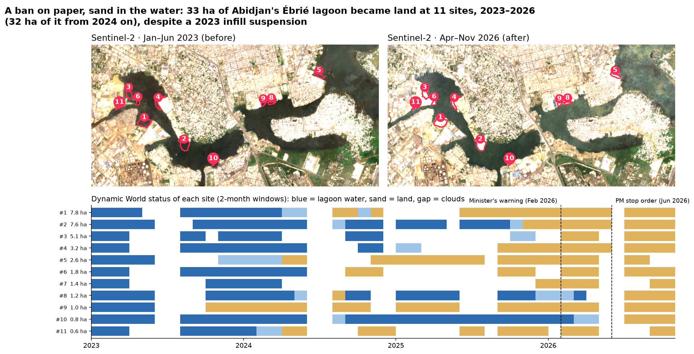

# Ghost Lakes: A ban on paper, sand in the water
*AI and 40 years of free satellite data to find water that cities bury, and a protected lagoon that kept shrinking.* · Track: Climate · Team of 2 high-school students

> In 2023 Côte d'Ivoire suspended the filling-in of Abidjan's Ébrié lagoon. From space, we watched **33 ha of it (≈46 football pitches) turn into land at 11 sites**, 32 ha of it from 2024 on. Every site was confirmed by two independent satellites.

**Problem.** A buried lake, pond or lagoon does not just disappear. It floods the new neighbourhood in heavy rain and stops recharging groundwater. These losses are rarely mapped, so people find out when the floods come. *Can AI and free satellite archives find buried water and say when it vanished?*

**Approach.** Everything runs in Google Earth Engine on free data.

1. **Terrain AI: where water *should* be.** A Random Forest trained on 23,000 points from 7 Romanian regions, with 10 terrain features (bare-earth DEM, depressions, slope, HAND, wetness…) and JRC water labels.
2. **Archive detector: where water *was*.** Permanent water seen by Landsat before 2010 that has been dry since 2015 and is built-up today. We ran it on 84 cities.
3. **Infill monitor: where water is disappearing *now*.** Dynamic World 2023 vs 2026, with every hit confirmed by Sentinel-1 radar (which sees through clouds) and dated to the month.
4. **Human review of every hit:** old vs new imagery, OpenStreetMap, news and papers.

**Results.**

- **The terrain AI generalises across regions:** AUC 0.977 when trained on 6 regions and tested on the 7th. Alone, it cannot find water bodies that vanished completely (AUC 0.57 on 4 documented ones in Bucharest), which is why we built steps 2–3.
- **The archive detector rediscovers known lost lakes on its own:**
    - Kalikiliki Dam, Lusaka: water until 2005, dry from 2007, matching a 2007 study saying it was "allowed to dry up" in late 2006;
    - Parangipalya Lake, now under Bengaluru's HSR Layout;
    - the filled lakes of Phnom Penh.
- **Abidjan, Ébrié lagoon.** The government acknowledged "dozens of hectares" filled despite the suspension, and the press reported that infill "continues in several sectors". **No locations, areas or dates were published.**
    - We mapped **11 sites, 33.0 ha**, each lagoon water for decades, optically water in 2023 and sand in 2026, and **4–7 dB brighter on radar**.
    - Radar also removed one optical false alarm.
    - **Two sites (~2 ha) were still water in early 2026 and land by July**, after the minister's February warning.
- **Global screen of ~120 cities for 2023–2026 infill:** everything else was a known megaproject (Manila Bay, Colombo, Dakar), a moving river or beach, or a documented event (Bucharest's Herăstrău drained in June 2026).

**Limitations.**

- We cannot tell which fills were authorised; Vridi port works may be legal.
- Fill dates are approximate (±1–2 months, cloud gaps), and 33 ha is a lower bound (sites ≥ 0.5 ha).
- Officials already know infill happens. Our contribution is public, independent, site-level evidence and dates, not to our knowledge published before.
- In Romania we found no new lost lakes; the top candidates were artefacts such as a sunken stadium pitch.

**Next.** Share the site list with local journalists and lagoon authorities for ground checks, monitor the lagoon monthly, and add historical maps for lakes lost before 1984. The code runs on any city: see `README.md`. The full write-up is in `WRITEUP_FULL.md`. *Data:* JRC Global Surface Water, Dynamic World, Sentinel-1/2, Landsat 5, FABDEM, MERIT Hydro, OpenStreetMap.
