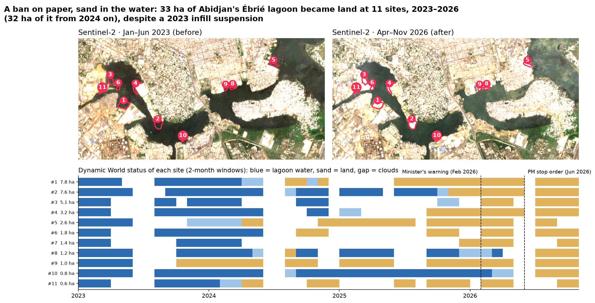

# Ghost Lakes: A ban on paper, sand in the water (full version)
### How two high-schoolers used AI and 40 years of satellite data to watch cities bury their water, and caught a protected lagoon still shrinking

**Track:** Climate · **Team:** 2 high-school students · **Code:** this repository

> In 2023, Côte d'Ivoire suspended the filling-in of Abidjan's Ébrié lagoon.
> From space, we watched **33 hectares of that lagoon turn into land** between early 2023 and late 2026, at 11 sites, month by month. **32 ha of it became land from 2024 onwards.**
> Every site was checked by two independent satellites. As far as we could find, none of them had been publicly mapped before.

## Problem
When a lake, pond or lagoon is filled in and built over, the water does not simply disappear. It floods the new neighbourhood in heavy rain and stops recharging groundwater. These losses are rarely mapped, so planners and residents often find out only after the floods begin. We asked: **can AI and 40 years of free satellite data find water bodies that cities have buried, and say when they disappeared?**

## Approach
1. **Terrain model (where water *should* be).** We trained a Random Forest in Google Earth Engine on 23,000 points from 7 Romanian regions. Its 10 features describe terrain only: FABDEM bare-earth elevation, slope, local depressions, height above the nearest drainage (HAND), upstream area, topographic wetness and distance to rivers. The labels come from JRC Global Surface Water (1984–2021) and are taken only on non-urban land. Applied to cities, the model flags built-up places whose terrain "wants" to be water.
2. **Vanished-water detector (where water *was*).** For 84 cities on 4 continents, we find pixels that the Landsat archive saw as permanent water before 2010, that have not been water since 2015 and that are built-up today (Dynamic World).
3. **Recent-infill monitor.** We compare Dynamic World water probability from 2023 to 2026 to catch lakes and lagoons being filled *right now*. Every hit must also be confirmed by Sentinel-1 radar, which sees through clouds, and we date each fill to the month.
4. **Manual verification of every finding.** We compare old and new imagery (Landsat 5 vs. Sentinel-2), check whether OpenStreetMap still maps water there, and search the web and the scientific literature for any prior record.

## Results
- **The model generalises.** Trained on 6 regions and tested on the 7th, it reaches a mean **AUC of 0.977** (F1 0.906). We also tested it, trained without any Bucharest data, on 6 historically documented drained lakes and buried streams in Bucharest:
  - It scores well where a park lake still remains (Cișmigiu, Tineretului: top 8% and top 4% of the city).
  - On the 4 water bodies that vanished completely, it is barely better than chance (AUC 0.57), and it misses spring-fed ponds on plateaus. Terrain alone cannot reveal these, which is why we added the satellite-archive detectors below.
- **The detector rediscovers known lost lakes without being told where to look:**
  - Parangipalya Lake under HSR Layout in Bengaluru.
  - Lusaka's Kalikiliki Dam. The archive shows water until 2005 and dry land from 2007, matching a 2007 paper's note that the dam was "allowed to dry up" in November 2006.
  - The filled lakes of Phnom Penh.
- **New finding: the Ébrié lagoon in Abidjan.** Côte d'Ivoire suspended lagoon infill in 2023. In February 2026 the Transport Minister acknowledged that "dozens of hectares" had been filled anyway, and in September 2026 the press reported that infill "continues in several sectors". **No locations, areas or dates were published.**
  - We mapped **33.0 ha of lagoon turned into land at 11 sites** between H1 2023 and 2026 (Vridi, Grands Moulins, Zone 3, Koumassi, Petit Bassam, M'pouto). One site (~1 ha) changed in mid-2023 and may predate the suspension, whose exact date is not public. The other 32 ha became land in 2024–2026.
  - Every site was **confirmed by two independent sensors** (the full pipeline reproduces this automatically: `lagoon_infill.py` → `abidjan_timing.py` → `abidjan_figures.py`):
    - **Optical:** dark water in 2023, sand platform in 2026 on Sentinel-2.
    - **Radar:** Sentinel-1 shows open water (−18 to −22 dB) in 2023, then 4–7 dB brighter after the fill.
    - Optical and radar together also caught one optical false alarm, which we removed.
  - Every site was persistent lagoon water for decades (JRC occurrence ≥ 50%).
  - **Two sites (~2 ha) were still water in early 2026 and had become land by July 2026**, after the minister's February warning and around the Prime Minister's June stop order. Radar also suggests about 1.7 ha of further fill at Vridi/Zone 3 and Koumassi in August–September 2026, but that evidence is weaker.
  - To our knowledge this is the first public, site-level map and timeline of the post-suspension infill.
- **Global screen for 2023–2026 infill (~120 cities).** Every radar-confirmed hit outside Abidjan turned out to be a known large project, a natural change or a documented event:
  - known coastal megaprojects: Manila Bay, Colombo Port City, Dakar port;
  - shifting rivers and beaches: Padma, Krishna, Lima;
  - the documented June 2026 drainage of Bucharest's Herăstrău Lake;
  - a pond filled inside a private Yangon housing estate.

## Limitations
- We cannot tell **which fills were authorised**. Port works in Vridi and Grands Moulins may be legal.
- **Cloud gaps** make the month of each fill accurate only to about ±1–2 months.
- The 0.5 ha minimum means **33 ha is a lower bound**.
- Press reports cite about 453 ha of the lagoon filled in total, so the authorities clearly know infill is happening. What is new in our work is the public, independent, site-by-site evidence and its dates, not the existence of infill.
- In Romania the terrain model found no new lost lakes. Its top candidates were artefacts (a sunken stadium pitch, excavations) or known floodplains. We report this rather than overclaim.
- "Not found online" reflects our searches in English and French, not proof that nobody knows.

## Impact & next steps
The same pipeline can run on any city using only free data. We would like to share the Abidjan site list with local journalists and lagoon-protection authorities for ground checks, monitor the lagoon monthly, and add historical maps to catch lakes lost before 1984.

**Data and tools:** JRC Global Surface Water v1.4, Google Dynamic World, Sentinel-2, Landsat 5, FABDEM, MERIT Hydro, OpenStreetMap; Google Earth Engine, scikit-learn, folium.
